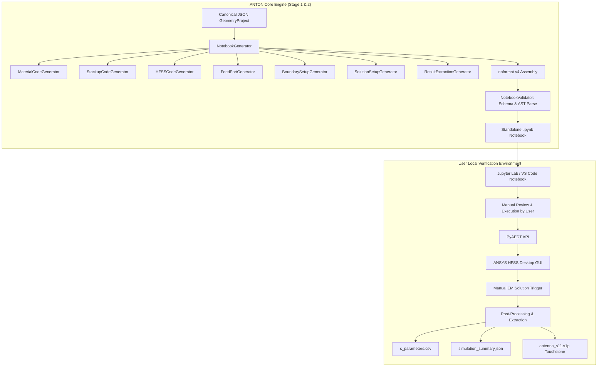

# ANTON: Notebook Generation Architecture & PyAEDT Reproduction Engine
**Stage 2 Technical Specification**

---

## 1. Architectural Philosophy: Decoupled Independent Execution

ANTON enforces strict architectural decoupling between antenna synthesis and electromagnetic simulation solvers:
- **No Direct Solver Execution by ANTON**: ANTON does **not** launch, direct, control, or solve within ANSYS Electronics Desktop (AEDT).
- **Zero Live PyAEDT Dependency**: The core ANTON engine does not require an active PyAEDT connection, COM server registration, or a local ANSYS license to design, validate, or export antennas.
- **Standalone Artifact Output**: ANTON generates an executable Jupyter Notebook (`.ipynb`) using `nbformat`. The user takes this self-contained artifact, inspects it, and executes it inside their own Jupyter/Python/AEDT environment.



---

## 2. Pipeline Sub-Modules & Code Generation Architecture

The notebook generation system is located in `src/anton/notebook/`:

| Sub-Module | Generator Class | Responsibilities |
| :--- | :--- | :--- |
| `notebook_generator.py` | `NotebookGenerator` | Orchestrates end-to-end assembly of Markdown and Code cells conforming to `nbformat` v4. |
| `notebook_validator.py` | `NotebookValidator` | Verifies JSON schema compliance, Python `ast.parse()` syntax correctness, section coverage, and design consistency. |
| `material_code_generator.py` | `MaterialCodeGenerator` | Synthesizes PyAEDT material definitions, handles standard library mapping (Copper, FR-4, Teflon), and creates custom dielectrics. |
| `stackup_code_generator.py` | `StackupCodeGenerator` | Constructs 3D substrate boxes and ground planes using physically exact $Z$-coordinates. |
| `hfss_code_generator.py` | `HFSSCodeGenerator` | Translates rectangular, circular, polygonal, and CSG cutouts/slots into PyAEDT modeler geometry with color tagging. |
| `feed_port_generator.py` | `FeedPortGenerator` | Constructs microstrip lumped ports, coaxial probe pins, and excitation sheets with integration lines. |
| `boundary_setup_generator.py` | `BoundarySetupGenerator` | Computes quarter-wave padding ($\lambda_0/4$) at operating frequency, builds airbox, and assigns radiation boundaries. |
| `solution_setup_generator.py` | `SolutionSetupGenerator` | Configures adaptive meshing setups (`HFSSDrivenAuto` or `HFSS`) and broadband interpolating frequency sweeps. |
| `result_extraction_generator.py` | `ResultExtractionGenerator` | Provides manual solve cells, mathematical derivations ($|\Gamma|$, VSWR, $Z_{\text{in}}$), far-field plotting, and multi-format export. |

---

## 3. Mathematical Metric Derivations & Physical Rigor

To prevent post-processing errors and ambiguities, the code synthesized in Section 10 of each generated notebook implements mathematically rigorous formulations:

### 3.1 Voltage Standing Wave Ratio (VSWR)
Derived strictly from the complex reflection coefficient $\Gamma = S_{11}$:
$$\Gamma = \text{Re}(S_{11}) + j\,\text{Im}(S_{11})$$
$$|\Gamma| = \sqrt{\text{Re}(S_{11})^2 + \text{Im}(S_{11})^2} = 10^{\frac{S_{11,\text{dB}}}{20}}$$
$$\text{VSWR} = \frac{1 + |\Gamma|}{1 - |\Gamma|}$$
Numerical clipping ($\epsilon = 10^{-4}$) is applied to avoid division by zero when $|\Gamma| \to 1$.

### 3.2 Complex Input Impedance
Derived from normalized transmission line theory referenced to characteristic impedance $Z_0 = 50\,\Omega$:
$$Z_{\text{in}} = R_{\text{in}} + j\,X_{\text{in}} = Z_0 \frac{1 + \Gamma}{1 - \Gamma}$$

### 3.3 Antenna Far-Field Quantities
Generated notebooks clearly differentiate and document three often-confused metrics:
1. **Directivity ($D$)**: Directional radiation intensity relative to an ideal isotropic radiator. Disregards conductor and dielectric thermal losses.
2. **Gain ($G$)**: Includes internal antenna ohmic and dielectric losses via radiation efficiency $\eta_{\text{rad}}$:
   $$G = \eta_{\text{rad}} D$$
3. **Realized Gain ($G_{\text{realized}}$)**: Includes both internal dissipation and reflection loss due to impedance mismatch:
   $$G_{\text{realized}} = (1 - |\Gamma|^2) G = (1 - |\Gamma|^2) \eta_{\text{rad}} D$$

---

## 4. Multi-Format Simulation Data Export Specifications

Generated notebooks write standardized outputs into `./simulation_outputs/`:

### 4.1 Touchstone 1-Port (`.s1p`)
Compliant with standard microwave EDA interchange formats (ADS, Microwave Office, CST):
```text
! Standard Touchstone 1-Port File generated by ANTON
! Format: Frequency (GHz) | S11 Real | S11 Imaginary | Reference Impedance: 50 Ohm
# GHz S RI R 50.0
2.000000 0.94210000 -0.05200000
...
```

### 4.2 S-Parameters CSV (`s_parameters.csv`)
Columns:
- `Frequency_GHz`: Frequency in GHz
- `S11_dB`: Return loss in decibels
- `S11_Real`: Real part of $S_{11}$
- `S11_Imag`: Imaginary part of $S_{11}$
- `VSWR`: Voltage standing wave ratio
- `R_in_Ohm`: Real input resistance ($R_{\text{in}}$)
- `X_in_Ohm`: Imaginary input reactance ($X_{\text{in}}$)

### 4.3 Simulation Summary JSON (`simulation_summary.json`)
Structured summary recording:
- `design_name`: Name of antenna
- `num_frequency_points`: Integer point count
- `frequency_range_ghz`: `[f_min, f_max]`
- `resonance_frequency_ghz`: Frequency at $\min(S_{11})$
- `minimum_s11_db`: Minimum return loss in dB
- `minimum_vswr`: Minimum VSWR value
- `impedance_at_resonance`: `{"R_Ohm": ..., "X_Ohm": ...}`
- `units`: `{"frequency": "GHz", "return_loss": "dB", "impedance": "Ohm"}`

---

## 5. Automated Verification & AST Syntax Validation

Every notebook generated by ANTON is pre-screened prior to saving or release using `NotebookValidator`:
1. **Schema Check**: Validates the notebook against the official Jupyter v4 schema via `nbformat.validate()`.
2. **Python Syntax Check**: Parses every code cell through the Python Abstract Syntax Tree (`ast.parse()`). Any indentation, syntax, or formatting defect triggers a validation exception.
3. **Section Coverage**: Ensures all 10 mandatory sections (imports, materials, stackup, patch, feed, airbox, sweep, solve, metrics, exports) are present.
4. **Offline Resilience**: All modeler calls are safeguarded (`if app is not None:`), allowing notebooks to be executed in headless CI/CD dry runs without AEDT desktop instances crashing the script.

