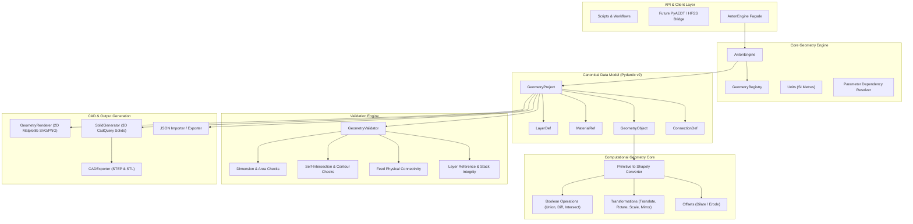

# ANTON Stage 1 — Universal Antenna Geometry Engine
## System Architecture & Technical Design Document

---

## 1. Executive Summary

**ANTON** is an advanced AI-powered universal microstrip patch antenna design, prediction, and optimization platform. **Stage 1** establishes the core scientific software foundation: a geometry-independent, parameter-driven, simulation-ready CAD engine capable of representing, creating, manipulating, validating, and exporting arbitrary planar microstrip antenna structures.

The system is not restricted to predefined antenna templates. It is built upon universal 2D geometric primitives, arbitrary polygon support, robust 2D constructive solid geometry (CSG) Boolean operations via Shapely, full physical layer and material stack management, and 3D OpenCASCADE solid modelling via CadQuery.

---

## 2. High-Level Architecture

The architecture is strictly decoupled into single-responsibility subsystems:

---

## 3. Subsystem Breakdown

### 3.1. Canonical Geometry Data Model (`anton.models.geometry_schema`)
- **Single Source of Truth**: The entire project state is captured in `GeometryProject`.
- **Validation Engine**: Built with Pydantic v2, enforcing non-empty identifiers, strict SI metre units, and polymorphic shape representations.
- **Components**:
  - `ParameterDef`: Parametric variables with linear dependency tracking.
  - `MaterialRef`: Physical metadata, dielectric properties ($\epsilon_r$, $\tan\delta$), or conductor conductivity ($\sigma$).
  - `LayerDef`: Physical vertical stack placement ($z$-position, thickness, type).
  - `GeometryObject`: Universal geometric primitive (rectangle, circle, ellipse, triangle, polygon, line, arc, custom contour, or boolean result).
  - `ConnectionDef`: Logical and topological relationships between elements (e.g. edge feed to patch).

### 3.2. Primitive Geometry Engine (`anton.primitives`)
Translates high-level parametric models into computational geometry entities:
- `rectangle_to_shapely`: Bounding box, rotation, center translation.
- `circle_to_shapely`: Buffered point with 128-segment polygonization.
- `ellipse_to_shapely`: Affine-scaled and rotated unit circle.
- `triangle_to_shapely`: Explicit 3-vertex polygon or equilateral synthesis.
- `polygon_to_shapely`: Arbitrary closed n-gon with optional interior holes.
- `custom_contour_to_shapely`: Arbitrary freeform contour with multiple cut-outs.
- `line_to_shapely` & `arc_to_shapely`: 1D guiding and feed path primitives.

### 3.3. Boolean & CSG Operations (`anton.operations`)
- **Topological Robustness**: Employs Shapely (GEOS C++ engine under the hood) for floating-point 2D planar polygon unions, differences, and intersections.
- **Hole Preservation**: Cutout operations (such as U-slots or annular inner circles) automatically preserve interior rings as `inner_vertices`.
- **Affine Transforms**: Deterministic translation, rotation about arbitrary centers, scaling, and axis mirroring.

### 3.4. Layer & Feed Management (`anton.layers`, `anton.feeds`)
- Multi-layer stackup ordered by $z$-position.
- Feed physical connectivity detection using geometric intersection and boundary contact algorithms ($< 1\,\mu\text{m}$ contact tolerance).

### 3.5. Geometry Validation Engine (`anton.validation`)
- Distinguishes fatal **ERRORS** (negative dimensions, zero-area geometry, self-intersecting loops, dangling material/layer references) from non-fatal **WARNINGS** (overlapping conductors, disconnected feeds, incomplete dielectric stacks).

### 3.6. 2D Visualization & 3D CAD (`anton.visualization`, `anton.cad`)
- **2D Rendering**: Multi-layer Matplotlib engine with alpha-blending, compound path hole rendering, SI dimension annotations, and export to SVG / PNG.
- **3D Solid Generation**: Uses OpenCASCADE via CadQuery. Extrudes planar contours to exact layer thicknesses, cuts internal slots, offsets along the $Z$-axis, and compiles multi-body assemblies.
- **CAD Exporter**: Direct generation of industry-standard STEP (ISO 10303) and STL (stereolithography) models.

---

## 4. Future Compatibility with PyAEDT / ANSYS HFSS

Stage 1 is designed specifically for automated consumption by Stage 2:
1. **Coordinate Determinism**: All coordinates are SI metres in standard Cartesian $XY$-plane with $+Z$ upward stackup.
2. **Layer Mapping**: Layer IDs, names, and thicknesses map directly to HFSS `hfss.modeler.create_coordinate_system` and 3D sheet/box extrusion primitives.
3. **Material Mapping**: Material records map directly to HFSS Material Library definitions (`Relative Permittivity`, `Dielectric Loss Tangent`, `Bulk Conductivity`).
4. **Clean Boundary Export**: Polygons with cutouts are converted directly into face objects ready for HFSS Boolean subtract operations or direct STEP assembly import.

