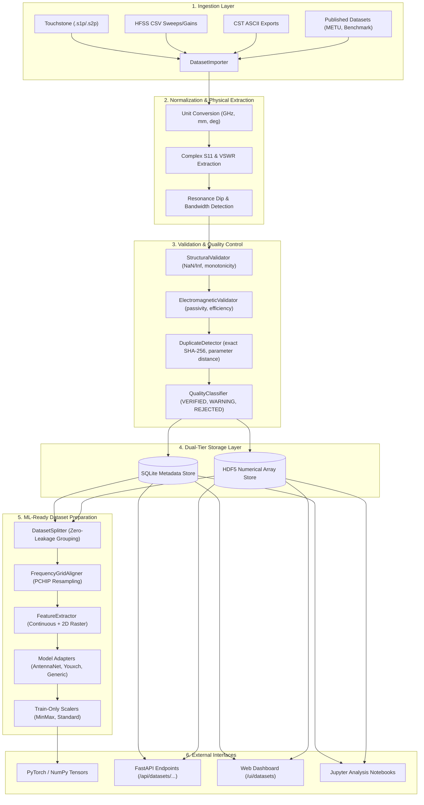

# ANTON — Stage 3 Dataset Architecture Specification

---

### 1. Architectural Overview

The ANTON Electromagnetic Dataset Subsystem is engineered to provide a robust, scientifically validated data backbone for AI-assisted antenna design. It bridges full-wave computational electromagnetics (FEM, FIT, MoM) with deep learning surrogate modeling and optimization.

---

### 2. Dual-Tier Storage Rationale

Electromagnetic simulation results exhibit a sharp divergence in data characteristics:
1. **Metadata & Relational Entities**:
   - Small, highly structured attributes (design ID, geometry family, dielectric constants, boundary conditions, convergence status, validation flags, tags).
   - Require fast indexing, multi-column filtering, pagination, and relational integrity.
   - **Storage Engine**: Relational SQLite database (`data/datasets/metadata.db`) configured with Write-Ahead Logging (`WAL`) mode and parameter-safe queries. The schema is fully compatible with future enterprise PostgreSQL migrations.
2. **High-Dimensional Numerical Arrays**:
   - Continuous frequency series ($401$ to $2001$ frequency points), complex scattering parameters ($S_{11,\text{re}}, S_{11,\text{im}}$), input impedance curves ($R_{\text{in}}, X_{\text{in}}$), realized gain sweeps, and 2D/3D far-field radiation pattern cuts ($\theta \times \phi$ grids).
   - Storing large binary BLOBs inside relational tables causes table bloat, degrades B-tree search performance, and impedes direct NumPy/SciPy vector operations.
   - **Storage Engine**: HDF5 format (`data/datasets/arrays.h5`) utilizing `h5py` with gzip chunked compression, allowing $O(1)$ random access to arbitrary records and direct zero-copy slicing into numerical arrays.

---

### 3. Canonical Geometry Linkage

ANTON strictly avoids maintaining competing or divergent geometric models:
- Every dataset record references the canonical Stage 1 `AntennaGeometry` JSON dictionary.
- A deterministic `geometry_hash` is computed as:
  $$\text{hash} = \text{SHA-256}(\text{JSON}(\text{geometry}, \text{sort\_keys}=\text{True}))$$
- This guarantees that arbitrary planar antenna geometries (rectangular, circular, annular, slotted, inset, triangular, hexagonal, or custom polygons) preserve their complete CAD topological definition without forcing artificial parameter collapse into a rectangular bounding box.

---

### 4. Zero Data Leakage Architecture

In antenna surrogate modeling, splitting dataset records purely at random produces catastrophic data leakage because parametric sweeps or repeated mesh passes of the identical antenna geometry contaminate both train and test splits:

$$\text{Leakage} = \text{Geometry}_{\text{train}} \cap \text{Geometry}_{\text{test}} \neq \emptyset$$

ANTON's `DatasetSplitter` enforces strict disjoint partitioning:
1. Records are grouped by `geometry_hash` into atomic geometry clusters.
2. Near-duplicate geometries (within configurable parameter distance $\epsilon \le 0.01$) are optionally merged into the same cluster.
3. Groups are shuffled using a reproducible pseudo-random seed and assigned atomically to `train`, `val`, or `test`.
4. The system validates that $\text{Train} \cap \text{Val} \cap \text{Test} = \emptyset$ before emitting the split manifest.

---

### 5. File Safety and Security Controls

The storage and ingestion subsystems incorporate defense-in-depth security practices:
- **Path Traversal Protection**: All file read/write operations pass through `is_safe_path(base_dir, target_path)` to ensure no requests escape designated working directories.
- **Upload Size Bounds**: Strict limits ($50\,\text{MB}$) prevent memory exhaustion attacks.
- **Safe Serialization**: Zero untrusted `pickle` deserialization. All transfers utilize standard JSON, HDF5, CSV, or NumPy `.npz`.
- **Atomic Operations**: All file writing uses temporary file replacement (`os.replace`) to prevent file corruption during sudden system shutdowns.

