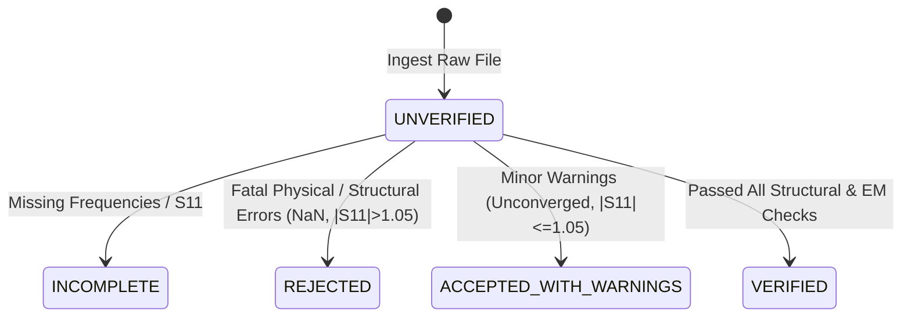

# ANTON — Stage 3 Data Validation and Quality Control Specification

---

### 1. Overview

Electromagnetic machine-learning surrogates are highly sensitive to unphysical artifacts, solver divergence, and data corruption. The ANTON validation engine in [src/anton/datasets/validation/](file:///c:/Users/adewa/Pictures/Anton%202/src/anton/datasets/validation/) implements multi-stage automated auditing across structural, numerical, electromagnetic, and duplicate detection dimensions.

---

### 2. Validation Rule Catalog

#### 2.1 Structural Validation Rules

| Rule Code | Severity | Description | Condition for Failure |
|---|---|---|---|
| `EMPTY_FREQUENCIES` | `ERROR` | Frequency grid has zero points. | `len(frequencies_ghz) == 0` |
| `NAN_OR_INF_FREQUENCY` | `ERROR` | Frequency values contain `NaN` or `Inf`. | `any(isnan(f) or isinf(f))` |
| `NON_POSITIVE_FREQUENCY`| `ERROR` | Negative or zero frequency points. | `any(f <= 0.0)` |
| `DISORDERED_FREQUENCIES`| `ERROR` | Frequencies not strictly increasing. | `frequencies_ghz[i] <= frequencies_ghz[i-1]` |
| `ARRAY_LENGTH_MISMATCH` | `ERROR` | Output response length $\neq$ frequency points. | `len(array) != len(frequencies_ghz)` |
| `NAN_IN_RESPONSE` | `ERROR` | Response array contains `NaN` values. | `any(isnan(val))` |
| `INF_IN_RESPONSE` | `ERROR` | Response array contains infinite values. | `any(isinf(val))` (excluding asymptotic VSWR) |
| `EMPTY_GEOMETRY` | `ERROR` | Missing canonical geometry specification. | `len(geometry) == 0` |
| `INVALID_PERMITTIVITY` | `ERROR` | Non-physical dielectric constant. | `permittivity_r <= 0.0` |
| `INVALID_SUBSTRATE_HEIGHT`| `ERROR` | Non-physical substrate thickness. | `substrate_thickness_mm <= 0.0` |

#### 2.2 Electromagnetic Physical Sanity Rules

| Rule Code | Severity | Physical Basis | Acceptance Threshold |
|---|---|---|---|
| `NON_PASSIVE_S11` | `ERROR` | Conservation of energy in passive one-port radiators dictates $\|S_{11}\| \le 1.0$ ($0\,\text{dB}$). | Violates $\|S_{11}\| \le 1.05$ ($S_{11,\text{dB}} \le +0.42\,\text{dB}$). |
| `SLIGHT_PASSIVITY_VIOLATION` | `WARNING` | High-frequency port de-embedding or numerical meshing boundary noise. | $1.0001 < \|S_{11}\| \le 1.05$. |
| `NEGATIVE_INPUT_RESISTANCE` | `ERROR` | Passive antennas cannot exhibit negative real input resistance. | $R_{\text{in}} < -0.1\,\Omega$. |
| `INVALID_VSWR` | `ERROR` | VSWR is bounded below by $1.0$ (perfect match). | $\text{VSWR} < 0.999$. |
| `COMPLEX_MAGNITUDE_INCONSISTENCY` | `ERROR` | Real and imaginary components must match linear magnitude. | $\|\sqrt{S_{11,\text{re}}^2 + S_{11,\text{im}}^2} - \|S_{11}\|\| > 10^{-3}$. |
| `INVALID_RADIATION_EFFICIENCY` | `ERROR` / `WARNING` | Power radiated divided by power accepted must reside in $[0, 1]$. | $\eta_{\text{rad}} < 0.0$ or $\eta_{\text{rad}} > 1.05$. |
| `UNUSUALLY_HIGH_GAIN` | `WARNING` | Single-element microstrip patch gain rarely exceeds $12\,\text{dBi}$. | $\text{Gain} > 30.0\,\text{dBi}$. |
| `UNCONVERGED_SIMULATION`| `WARNING` | Solver adaptive passes reached limit before satisfying $\Delta S$ criterion. | `is_converged == False`. |

---

### 3. Duplicate and Near-Duplicate Detection Engine

ANTON's `DuplicateDetector` catalogs duplicate relationships without deleting legitimate independent simulation passes:
1. **Exact Geometry Hashing**:
   Computes SHA-256 over canonical JSON string with sorted keys and normalized whitespace. Designs sharing identical geometry hashes are grouped.
2. **Near-Duplicate Parameter Distance**:
   Calculates normalized Euclidean distance between continuous parameters $(W, L, h, \varepsilon_r, x_f, y_f)$:
   $$D(A, B) = \sqrt{\frac{1}{K} \sum_{k=1}^K \left( \frac{p_{A,k} - p_{B,k}}{\frac{1}{2}(|p_{A,k}| + |p_{B,k}|)} \right)^2}$$
   Pairs with $D(A, B) \le 0.01$ ($1\%$ relative difference) are flagged as near-duplicates.
3. **Solver & Mesh Disambiguation**:
   Geometrically identical designs simulated under different solvers (e.g. HFSS vs CST), different mesh densities, or varying loss tangents are recognized as distinct experimental records and preserved independently.

---

### 4. Data-Quality Classification Levels

Every dataset record is graded into one of five statuses:

- **`VERIFIED`**: Meets all structural and physical checks, authenticated full-wave simulation or measurement. Eligible for trusted training and benchmarking.
- **`ACCEPTED_WITH_WARNINGS`**: Structurally sound but contains minor warnings (e.g. slight de-embedding edge ripple, unconverged mesh). Eligible for training with cautionary weighting.
- **`INCOMPLETE`**: Missing essential fields (e.g. sweep truncated before completion, missing substrate height).
- **`REJECTED`**: Severely invalid data (NaN, negative permittivity, non-passive response). Excluded from training workflows.
- **`UNVERIFIED`**: Initial status prior to automated validation execution.
